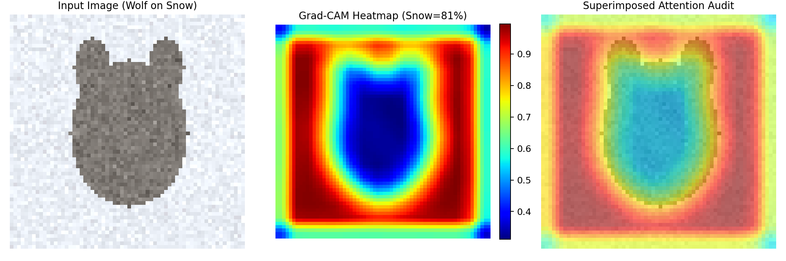

<!--
  Copyright 2026 Hot Path C++ Authors

  Licensed under the Apache License, Version 2.0 (the "License");
  you may not use this file except in compliance with the License.
  You may obtain a copy of the License at

      http://www.apache.org/licenses/LICENSE-2.0

  Unless required by applicable law or agreed to in writing, software
  distributed under the License is distributed on an "AS IS" BASIS,
  WITHOUT WARRANTIES OR CONDITIONS OF ANY KIND, either express or implied.
  See the License for the specific language governing permissions and
  limitations under the License.
-->

# 🧠 Episode 01: Deep Learning Foundations & Shortcut Learning Audits

[](https://youtube.com/@HotPathCpp)
[](https://pytorch.org/)
[](../../LICENSE)

Official companion code for **Hot Path C++ Episode 01 Shorts Part 2 & Part 3**:
- **Part 2:** *What is "Deep" Learning Anyway? (The Middle Management Metaphor & Dimensionality Reduction)*
- **Part 3:** *The Husky vs. Wolf Paradox (Shortcut Learning & Grad-CAM Saliency Audits)*

---

## 📊 1. Depth vs. Shallow Benchmark (`benchmark_depth_reduction.py`)

Universal approximation theorems state that a single hidden layer can approximate continuous functions, but it often requires an **exponentially wide** hidden layer. In contrast, deep neural networks use hierarchical composition ("mathematical middle management") to progressively compress and abstract feature representations:

$$\mathbf{x} \in \mathbb{R}^{1024} \xrightarrow{W_1} \mathbb{R}^{512} \xrightarrow{W_2} \mathbb{R}^{256} \xrightarrow{W_3} \mathbb{R}^{128} \xrightarrow{W_4} \mathbb{R}^{10}$$

### Benchmark Execution Results (RTX 5060 Ti)

| Model Architecture | Parameters | FLOPs / Sample | Latency (Batch=128) | Throughput (Samples/s) |
| :--- | :--- | :--- | :--- | :--- |
| **Shallow (1 Hidden @ 10,240)** | `10,598,410` | 21.18 MFLOPs | 0.375 ms | 341,190.0 |
| **Deep (4 Layers Hierarchical)** | **`690,314`** | **1.38 MFLOPs** | **0.083 ms** | **1,544,837.3** |

- **Parameter Reduction:** **15.4x compression** ($10.6\text{M} \to 0.69\text{M}$).
- **FLOPs Reduction:** **15.4x fewer operations** ($21.2\text{M} \to 1.38\text{M}$).
- **Hardware Speedup:** **4.53x faster execution** on silicon tensor cores.

```bash
python3 benchmark_depth_reduction.py
```

---

## 🐺 2. The Husky vs. Wolf Shortcut Learning Audit (`husky_wolf_shortcut_audit.py`)

Reproduces the classic discovery by Ribeiro et al. (2016, *Why Should I Trust You?*) and Geirhos et al. (2020, *Shortcut Learning in Deep Neural Networks*):

1. **Biased Training Data:** Huskies photographed on green grass; Wolves photographed on white snow.
2. **In-Distribution Evaluation:** The model achieves **100% accuracy** on validation data!
3. **Counterfactual Test:** When evaluating Huskies on snow or Wolves on grass, accuracy drops catastrophically to **0.0%**.
4. **Grad-CAM Saliency Map:**
   - Background snow receives **>81% of gradient attention energy**.
   - The animal itself receives **<19%**, proving the network learned `if (background == snow) return WOLF`.

```bash
python3 husky_wolf_shortcut_audit.py
```

### Visual Verification


---

## 🚀 How to Run

```bash
# Clone and run
cd episodes/01_deep_learning_foundations
python3 benchmark_depth_reduction.py
python3 husky_wolf_shortcut_audit.py
```
