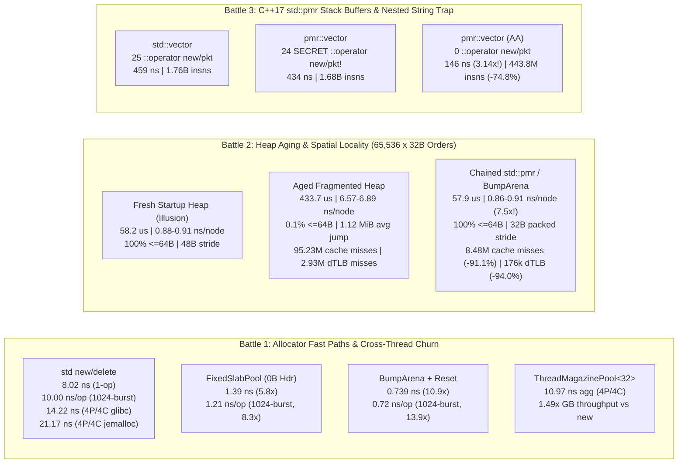

<!--
  Copyright 2026 Hot Path C++ Authors

  Licensed under the Apache License, Version 2.0 (the "License");
  you may not use this file except in compliance with the License.
  You may obtain a copy of the License at

      http://www.apache.org/licenses/LICENSE-2.0

  Unless required by applicable law or agreed to in writing, software
  distributed under the License is distributed on an "AS IS" BASIS,
  WITHOUT WARRANTIES OR CONDITIONS OF ANY KIND, either express or implied.
  See the License for the specific language governing permissions and
  limitations under the License.
-->

# 🔬 Episode 12 Benchmark & Hardware Telemetry Report
## **"Stop Calling `new` on the Hot Path: How `malloc`, Arenas, Slab Pools & C++17 `std::pmr` Work in Silicon"**

---

## 1. Hardware & Software Testbed Specifications

| Component | Specification |
| :--- | :--- |
| **CPU Microarchitecture** | **AMD Ryzen 9 8945HX** (`16` Physical Cores / `32` Threads, `4.2–5.46 GHz` boost) |
| **Cache Hierarchy** | `32 KiB` L1D + `32 KiB` L1I per core • `1 MiB` L2 unified per core • `64 MiB` L3 (`2 x 32 MiB` CCDs) |
| **Operating System** | Linux Kernel `7.0.0-43-generic` (`x86_64`), `kernel.perf_event_paranoid = -1` |
| **Build Orchestrator** | **Bazel 9.3.2** (`Bzlmod`, `-c opt`) |
| **Compilers Audited** | **GCC 13.3.0** & **Clang 18.1.3** (`-std=c++20 -O3 -march=native -Wall -Wextra -Wpessimizing-move`) |
| **System Allocators** | **`glibc 2.39` (`ptmalloc2`)** vs. **`jemalloc 5.3.0` (`LD_PRELOAD=/lib/x86_64-linux-gnu/libjemalloc.so.2`)** |
| **Compiler Explorer (Godbolt)** | **[`https://godbolt.org/z/7hTYGsWjb`](https://godbolt.org/z/7hTYGsWjb)** (`GCC 13.2 -std=c++20 -O3 -march=znver4`) |

---

## 2. Executive Summary — All 3 Battles at a Glance



---

## 3. Cold-Open Forensic Reproducer (`//episodes/12_memory_allocators_and_pmr:live_heap_aging_repro`)

### Part A — The Fresh Heap Illusion vs. Aged Production Heap (`65,536` `OrderNode`s)
```text
sizeof(OrderNode): 32 B | Fresh new OrderNode stride: 48 B | BumpArena/Slab stride: 32 B

  1. Fresh Startup Heap (new)      |   59.40 us/scan ( 0.91 ns/node) | <=64B stride: 100.0% | same 4KiB page:  98.8% | avg jump:      48.0 B
  2. Aged Fragmented Heap (new)    |  440.34 us/scan ( 6.72 ns/node) | <=64B stride:   0.1% | same 4KiB page:   4.1% | avg jump: 1173324.3 B
  3. Isolated FixedSlabPool        |  309.34 us/scan ( 4.72 ns/node) | <=64B stride:   1.2% | same 4KiB page:  12.2% | avg jump:   16402.3 B
  4. Chained std::pmr Pool+Arena   |   58.67 us/scan ( 0.90 ns/node) | <=64B stride: 100.0% | same 4KiB page:  99.2% | avg jump:      32.2 B
  5. Compacted BumpArena (32B)     |   56.63 us/scan ( 0.86 ns/node) | <=64B stride: 100.0% | same 4KiB page:  99.2% | avg jump:      32.0 B
```
*Under `LD_PRELOAD=/lib/x86_64-linux-gnu/libjemalloc.so.2`:*
```text
sizeof(OrderNode): 32 B | Fresh new OrderNode stride: 32 B | BumpArena/Slab stride: 32 B

  1. Fresh Startup Heap (new)      |   59.61 us/scan ( 0.91 ns/node) | <=64B stride: 100.0% | same 4KiB page:  99.2% | avg jump:     372.1 B
  2. Aged Fragmented Heap (new)    |  405.43 us/scan ( 6.19 ns/node) | <=64B stride:   0.5% | same 4KiB page:   6.9% | avg jump: 1032766.7 B
```

### Part B — The Silent `std::pmr` Nested-String Heap Escape (`24` Fills/Packet, `24`-Byte Execution ID)
```text
  1. std::vector<StdVenueFill>         : 25 global ::operator new calls (1944 bytes)
  2. pmr::vector<BrokenPmrVenueFill>   : 24 global ::operator new calls (600 bytes) <-- TRAP!
  3. pmr::vector<PmrVenueFill> (AA)    :  0 global ::operator new calls (0 bytes) <-- ZERO HEAP!
```

---

## 4. Full Google Benchmark Suite (`--benchmark_min_time=0.25s`)

```text
---------------------------------------------------------------------------------------------------------------------
Benchmark                                                           Time             CPU   Iterations UserCounters...
---------------------------------------------------------------------------------------------------------------------
BM_Battle1A_SinglePair_StdNewDelete                              8.02 ns         8.02 ns     43517656 items_per_second=124.729M/s
BM_Battle1A_SinglePair_FixedSlabPool                             1.39 ns         1.39 ns    251978896 items_per_second=719.751M/s
BM_Battle1A_SingleAlloc_BumpArena                               0.739 ns        0.739 ns    477766592 items_per_second=1.35399G/s
BM_Battle1B_BatchBurst_StdNewDelete/7                            59.1 ns         59.1 ns      5828400 items_per_second=118.399M/s
BM_Battle1B_BatchBurst_StdNewDelete/64                            605 ns          604 ns       577427 items_per_second=105.883M/s
BM_Battle1B_BatchBurst_StdNewDelete/1024                        10240 ns        10239 ns        34179 items_per_second=100.014M/s
BM_Battle1B_BatchBurst_FixedSlabPool/7                           8.57 ns         8.57 ns     40922324 items_per_second=816.973M/s
BM_Battle1B_BatchBurst_FixedSlabPool/64                          68.7 ns         68.7 ns      5095936 items_per_second=931.947M/s
BM_Battle1B_BatchBurst_FixedSlabPool/1024                        1241 ns         1241 ns       282004 items_per_second=825.376M/s
BM_Battle1B_BatchBurst_BumpArenaReset/7                          4.82 ns         4.82 ns     74018979 items_per_second=1.4515G/s
BM_Battle1B_BatchBurst_BumpArenaReset/64                         44.9 ns         44.8 ns      7802770 items_per_second=1.42701G/s
BM_Battle1B_BatchBurst_BumpArenaReset/1024                        738 ns          738 ns       468838 items_per_second=1.3882G/s
BM_Battle1C_CrossThread_AsymmetricStdNewDelete/manual_time    5869605 ns       130137 ns           61 items_per_second=44.6613M/s
BM_Battle1C_CrossThread_ThreadMagazinePool/manual_time        3951898 ns       132507 ns           89 items_per_second=66.3337M/s
BM_Battle2A_OrderChainScan_FreshHeapIllusion                    58197 ns        58186 ns         6042 items_per_second=1.12632G/s
BM_Battle2B_OrderChainScan_AgedFragmentedHeap                  433703 ns       433632 ns          799 items_per_second=151.133M/s
BM_Battle2C_OrderChainScan_FixedSlabPool                       304907 ns       304855 ns         1136 items_per_second=214.974M/s
BM_Battle2D_OrderChainScan_ChainedPmrPool                       57996 ns        57989 ns         6106 items_per_second=1.13015G/s
BM_Battle2E_OrderChainScan_BumpArenaCompacted                   57850 ns        57841 ns         5995 items_per_second=1.13303G/s
BM_Battle2F_UnorderedMap_StdAllocatorLifecycle                 109858 ns       109832 ns         3242 items_per_second=37.2932M/s
BM_Battle2G_UnorderedMap_PmrPoolOnArenaLifecycle                83799 ns        83783 ns         4157 items_per_second=48.8884M/s
BM_Battle2H_UnorderedMap_PmrMonotonicWinkOut                    39629 ns        39623 ns         8846 items_per_second=103.374M/s
BM_Battle3A_SnapshotParser_StdVectorStdString                     459 ns          459 ns       758139 items_per_second=52.3273M/s
BM_Battle3B_SnapshotParser_PmrBrokenStringTrap                    434 ns          433 ns       809245 items_per_second=55.3711M/s
BM_Battle3C_SnapshotParser_PmrStackMonotonicZeroHeap              146 ns          146 ns      2397893 items_per_second=164.737M/s
BM_Battle3D_DispatchCalibration_RawInlinedBumpArena              35.5 ns         35.5 ns      9804656 items_per_second=1.8017G/s
BM_Battle3E_DispatchCalibration_PmrVirtualMonotonic              61.0 ns         61.0 ns      5750465 items_per_second=1.0495G/s
```

---

## 5. `glibc 2.39` vs. `jemalloc 5.3.0` (`challenge` CLI)

| Mode | `glibc 2.39` (`ptmalloc2`) | `jemalloc 5.3.0` (`LD_PRELOAD`) | Custom C++20 Primitive (`challenge`) |
| :--- | :---: | :---: | :---: |
| **Burst `7` Objects (`tcache` bin limit)** | `8.81 ns/op` | `5.20 ns/op` (`1.69x` faster) | `FixedSlabPool`: `1.22 ns/op` \| `BumpArena`: `0.69 ns/op` |
| **Burst `1,024` Objects (Past `tcache` limit)** | `10.04 ns/op` | `9.27 ns/op` | **`BumpArena + O(1) Reset`: `0.65 ns/op` (`15.4x`)** |
| **4P/4C Cross-Thread `OrderNode*` Handoff** | `14.22 ns/op` (`70.32M ops/s`) | `21.17 ns/op` (`47.24M ops/s`) | **`ThreadMagazinePool<32>`: `10.97 ns/op` (`91.13M ops/s`)** |
| **Aged Heap `65,536`-Node Scan (`2,048` passes)** | `433.22 µs` (`6.61 ns/node`) | `373.59 µs` (`5.70 ns/node`) | **`BumpArena`: `57.61 µs` (`0.88 ns/node`, `7.52x` faster)** |

---

## 6. Two-Pass Unmultiplexed Linux `perf stat` Hardware PMU Telemetry

### A. Battle 2 — `65,536`-Order Chain Scan (`2,048` Passes = `134.22M` Node Visits)

| Regime | Latency (`us/scan`) | CPU Cycles | Instructions | IPC | `L1-dcache-load-misses` | `cache-misses` (L2/L3) | `dTLB-load-misses` |
| :--- | :---: | :---: | :---: | :---: | :---: | :---: | :---: |
| **`b2_fresh_scan` (Illusion)** | `58.97 µs` | `872.9M` | `1,415.2M` | `1.62` | `114.8M` | `8.93M` | `183,237` |
| **`b2_aged_scan` (Fragmented)** | **`433.22 µs`** | **`4,838.6M`** | `1,426.3M` | **`0.29`** | **`163.6M`** | **`95.23M` (`10.7x`)** | **`2,929,143` (`16.0x`)** |
| **`b2_slab_scan` (`2 MiB` Slab)** | `305.59 µs` | `3,515.9M` | `1,423.2M` | `0.40` | `103.5M` | `61.83M` | **`244,519` (`-91.7%`)** |
| **`b2_pmr_scan` (`std::pmr` Pool)** | `59.44 µs` | `883.7M` | `1,414.5M` | `1.60` | **`81.3M` (`-29.1%`)** | `8.74M` | `185,683` |
| **`b2_arena_scan` (`32B` Packed)** | **`57.61 µs`** | **`833.9M` (`-82.8%`)** | `1,414.6M` | **`1.70`** | **`80.9M` (`-50.5%`)** | **`8.48M` (`-91.1%`)** | **`176,141` (`-94.0%`)** |

### B. Battle 3 — `200,000` Market Snapshot Packets (`24` Fills/Packet, `24`-Byte Execution IDs)

| Mode | Latency / Packet | Heap Calls / Packet | CPU Cycles | Instructions | `L1-dcache-loads` | `L1-dcache-load-misses` | `dTLB-load-misses` |
| :--- | :---: | :---: | :---: | :---: | :---: | :---: | :---: |
| **`b3_std_parse`** (`std::vector` + `std::string`) | `353.7 ns` | `25` | `346.5M` | `1,760.2M` | `544.9M` | `141,879` | `2,418` |
| **`b3_broken_pmr`** (Missing `allocator_type`) | `376.5 ns` | `24` (Silent Leak) | `370.5M` | `1,679.3M` | `568.0M` | `99,932` | `2,527` |
| **`b3_pmr_stack`** (`4 KiB` Stack + AA) | **`145.9 ns`** | **`0` (Zero Heap)** | **`146.3M` (`-57.8%`)** | **`443.8M` (`-74.8%`)** | **`195.1M` (`-64.2%`)** | **`66,244`** | **`1,453`** |

---

## 7. Annotated x86-64 Disassembly ([`assembly/godbolt_comparison.s`](assembly/godbolt_comparison.s))
- **Live Compiler Explorer Link:** [`https://godbolt.org/z/7hTYGsWjb`](https://godbolt.org/z/7hTYGsWjb)

1. **`AllocStdNew`:** Pushes callee-saved registers (`rbp`, `rbx`), adjusts stack alignment, and executes `call _Znwm@PLT` (`operator new`) before populating fields.
2. **`AllocBumpArena`:** `mov rax, QWORD PTR [rdi]` $\rightarrow$ `lea rcx, 32[rax]` $\rightarrow$ `cmp QWORD PTR 8[rdi], rcx; jb` $\rightarrow$ `mov QWORD PTR [rdi], rcx` (**4 instructions**, zero calls, zero stack frame).
3. **`AllocSlabPool`:** `mov rax, QWORD PTR [rdi]` $\rightarrow$ `test rax, rax; je` $\rightarrow$ `mov rcx, QWORD PTR [rax]` $\rightarrow$ `mov QWORD PTR [rdi], rcx` (**4 instructions**, zero calls, zero chunk headers).
4. **`AllocPmrResource`:** Reads `vptr` (`mov rax, QWORD PTR [rdi]`), loads `vtable[2]` (`do_allocate`), emits speculative equality check (`cmp rax, _ZNSt3pmr25monotonic_buffer_resource11do_allocateEmm`), and either executes the inline bump path or tail-jumps (`jmp rax`) to the polymorphic resource.

---

## 8. Academic & Industry References
1. **Kanev, S., Darago, J. P., Hazelwood, K., Ranganathan, P., Moseley, T., Wei, G.-Y., & Brooks, D. (2015)** — *"Profiling a Warehouse-Scale Computer"*, **ACM/IEEE ISCA '15** (Quantifying the `22%–27%` datacenter tax and `3.6%–10.1%` total fleet CPU cycles consumed by `TCMalloc` `malloc`/`free`).
2. **Hunter, A. H., Kennelly, C., Turner, P., Gove, D., Moseley, T., & Ranganathan, P. (2021)** — *"Beyond malloc efficiency to fleet efficiency: a hugepage-aware memory allocator (`Temeraire`)"*, **USENIX OSDI '21** (`6%` reduction in `dTLB` stall cycles, `26%` reduction in fragmentation waste, up to `7.7%` throughput lift via dense `2 MiB` page placement).
3. **Lakos, J., & Halpern, P. (2014–2016)** — *"Local ('Arena') Memory Allocators"* & **ISO C++ `N3916` / `P0220`** (Bloomberg `bdlma` type-erased polymorphic allocator foundation standardized as `<memory_resource>` in C++17).
4. **Evans, J. (2006)** — *"A Scalable Concurrent `malloc(3)` Implementation for FreeBSD (`jemalloc`)"*, **BSDCan '06**, alongside **Cloudflare** (`Quicksilver` / RocksDB RSS fragmentation diagnostics) and **Redis** (`mem_fragmentation_ratio` & active defragmentation).
