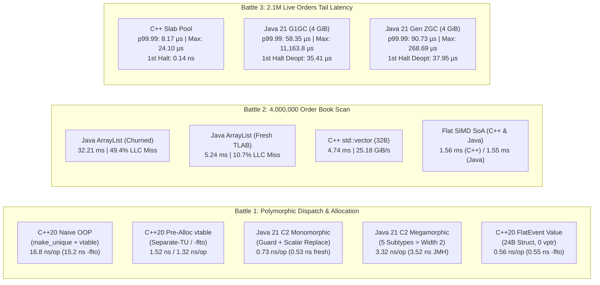

<!--
  Copyright 2026 Hot Path C++ Authors

  Licensed under the Apache License, Version 2.0 (the "License");
  you may not use this file except in compliance with the License.
  You may obtain a copy of the License at

      http://www.apache.org/licenses/LICENSE-2.0

  Unless required by applicable law or agreed to in writing, software
  distributed under the License is distributed on an "AS IS" BASIS,
  WITHOUT WARRANTIES OR CONDITIONS OF ANY KIND, either express or implied.
  See the License for the specific language governing permissions and
  limitations under the License.
-->

# 🔬 Episode 13 Benchmark & Hardware Telemetry Report
## **"Is C++ Actually Faster Than Java? (When the JIT Wins, Why It Loses & What 'Fast' Means in Production)"**

---

## 1. Hardware & Software Testbed Specifications

| Component | Specification |
| :--- | :--- |
| **CPU Microarchitecture** | **AMD Ryzen 9 9950X** (16 Physical Cores / 32 Threads, Zen 5, up to 5.7 GHz boost) |
| **Cache Hierarchy** | `48 KiB` L1D per core (12-way) • `1 MiB` L2 per core (16-way) • `64 MiB` Shared L3 (`2 x 32 MiB` CCDs) |
| **TLB Hierarchy** | `72`-entry L1 `dTLB` (full associativity) • `3,072`-entry L2 `dTLB` (`4 KiB` / `2 MiB` pages) |
| **Operating System** | Linux Kernel `7.0` (`x86_64`) with unmultiplexed hardware PMU `perf_event_paranoid` access |
| **Build Orchestrator** | **Bazel 9.3.0** (`Bzlmod` via [`MODULE.bazel`](../../MODULE.bazel)) |
| **C++20 Toolchain** | **GCC 13.3.0** (`-std=c++20 -O3 -march=native -Wall -Wextra -Wpessimizing-move` and `-flto`) + **Google Benchmark 1.9.5** |
| **Java 21 Toolchain** | **Hermetic OpenJDK 21.0.2 LTS** (`HotSpot 64-Bit Server VM`, Tier 4 C2 JIT, `-Xms4g -Xmx4g -XX:+AlwaysPreTouch`) + **OpenJDK JMH 1.37** |

---

## 2. Executive Summary — All 3 Architectural Battles at a Glance



---

## 3. Battle 1: Dynamic Allocation, Devirtualization & The Megamorphic Cliff

### 3.1 Complete Benchmark Results (C++20 Google Benchmark, Java 21 JMH & Forensic Challenge)

| Benchmark / Regime | C++20 (Separate TU) | C++20 (`-flto`) | Java 21 (Forensic) | Java 21 (JMH 1.37) | Relative Verdict |
| :--- | :---: | :---: | :---: | :---: | :--- |
| **Naive OOP (`make_unique` / `new` + Virtual Dispatch, Monomorphic)** | **`16.8 ns/op`** (`59.7M/s`) | **`15.2 ns/op`** (`66.0M/s`) | **`0.73 ns/op`** (`1.38G/s`) | **`0.89 ns/op`** (`1.12G/s`) | **Java C2 is `22.9x` faster** (`18.9x` JMH) via Escape Analysis |
| **Fresh Event + Result Allocated Inside Hot Loop** | **`16.8 ns/op`** (`59.7M/s`) | **`15.2 ns/op`** (`66.0M/s`) | **`0.53 ns/op`** (`1.89G/s`) | **`0.67 ns/op`** (`1.50G/s`) | **Java C2 is `31.7x` faster**; both allocations scalar-replaced |
| **Pre-Allocated Polymorphic Ring (`ProcessNoAlloc`, Monomorphic)** | **`1.52 ns/op`** (`658.9M/s`) | **`1.32 ns/op`** (`757.8M/s`) | **`0.73 ns/op`** (`1.38G/s`) | **`0.89 ns/op`** (`1.12G/s`) | **Java C2 is `2.08x` faster** than Separate-TU C++ (`1.80x` vs `-flto`) |
| **Bimodal Polymorphic Stream (`50%` Limit / `50%` Cancel)** | **`1.52 ns/op`** | **`1.32 ns/op`** | **`2.66 ns/op`** | **`2.55 ns/op`** | 2-way Polymorphic Inline Cache (PIC) slows Java by **`3.6x`** |
| **Megamorphic Stream (`20% x 5` Concrete Subtypes)** | **`1.61 ns/op`** | **`1.32 ns/op`** | **`3.32 ns/op`** | **`3.52 ns/op`** | `-XX:TypeProfileWidth=2` overflow causes **`4.5x` Java cliff** |
| **Idiomatic C++20 Flat Value (`FlatEvent` `24B` struct, 5 Subtypes)** | **`0.56 ns/op`** (`1.78G/s`) | **`0.55 ns/op`** (`1.82G/s`) | — | — | **C++ Flat Value wins overall (`1.82 G ops/s`)**, immune to traffic mix |

#### Raw Google Benchmark Output (`//episodes/13_cpp_vs_java_jit:benchmark` & `benchmark_lto`)
```text
------------------------------------------------------------------------------------------------------------------------
Benchmark                                                              Time             CPU   Iterations UserCounters...
------------------------------------------------------------------------------------------------------------------------
# Standard Separate-TU Compilation (cpp_vs_java_jit_oop_tu.cc compiled separately)
BM_Battle1_Cpp_NaiveOop_HeapAndVirtual/0                            16.8 ns         16.8 ns     41878636 items_per_second=59.6873M/s
BM_Battle1_Cpp_NaiveOop_HeapAndVirtual/1                            17.0 ns         17.0 ns     41008568 items_per_second=58.7885M/s
BM_Battle1_Cpp_CrossTuVirtual_NoAlloc/0                             1.52 ns         1.52 ns    460495679 items_per_second=658.91M/s
BM_Battle1_Cpp_CrossTuVirtual_NoAlloc/1                             1.61 ns         1.61 ns    432693954 items_per_second=619.655M/s
BM_Battle1_Cpp_IdiomaticFlatValue/0                                0.567 ns        0.567 ns   1000000000 items_per_second=1.76348G/s
BM_Battle1_Cpp_IdiomaticFlatValue/1                                0.562 ns        0.562 ns   1000000000 items_per_second=1.77829G/s

# Whole-Program Link-Time Optimization (-flto)
BM_Battle1_Cpp_NaiveOop_HeapAndVirtual/0                            15.2 ns         15.2 ns     46560919 items_per_second=66.0056M/s
BM_Battle1_Cpp_CrossTuVirtual_NoAlloc/0                             1.32 ns         1.32 ns    531438849 items_per_second=757.826M/s
BM_Battle1_Cpp_IdiomaticFlatValue/1                                0.549 ns        0.549 ns   1000000000 items_per_second=1.82112G/s
```

#### Raw Java 21 JMH Output (`//episodes/13_cpp_vs_java_jit:java_benchmarks`)
```text
------------------------------------------------------------------------------------------------------------------------
Benchmark                                                              Mode       Time (ns)     99.9% CI            Throughput
------------------------------------------------------------------------------------------------------------------------
BM_Battle1_Java21_FreshEventAndResultAlloc                             avgt         0.67 ns    ± 0.02 ns      1498.81 M ops/s
BM_Battle1_Java21_Monomorphic_EscapeAnalysis                           avgt         0.89 ns    ± 0.04 ns      1119.53 M ops/s
BM_Battle1_Java21_Bimodal_TwoReceiverPIC                               avgt         2.55 ns    ± 0.05 ns       391.74 M ops/s
BM_Battle1_Java21_Megamorphic_VirtualCall                              avgt         3.52 ns    ± 0.04 ns       284.48 M ops/s
------------------------------------------------------------------------------------------------------------------------
```

---

### 3.2 Code Snippets & Disassembly Involved in Battle 1

#### A. C++20 Naive Cross-TU OOP vs. Idiomatic `FlatEvent` Value Struct ([`cpp_vs_java_jit.h`](cpp_vs_java_jit.h) & [`cpp_vs_java_jit_oop_tu.cc`](cpp_vs_java_jit_oop_tu.cc))
```cpp
// 1. Naive Java-Style C++ OOP (Defined across a separate translation unit in cpp_vs_java_jit_oop_tu.cc)
struct OrderResult {
  int64_t notional;
  int64_t fee_ticks;
};

class Event {
 public:
  virtual ~Event() = default;
  // Allocates a fresh std::unique_ptr<OrderResult> on the heap on every call:
  virtual std::unique_ptr<OrderResult> ProcessHeapAlloc() const = 0;
  // Pre-allocated virtual dispatch without per-call OrderResult heap allocation:
  virtual OrderResult ProcessNoAlloc() const noexcept = 0;
};

// Separate-TU factory prevents single-TU compile-time devirtualization:
std::unique_ptr<Event> MakeEventByType(uint8_t type_tag, int64_t price,
                                       int64_t qty, int64_t aux) noexcept;

// 2. Idiomatic C++20 Flat Value Semantics (24-byte contiguous struct, zero vptr, zero heap)
struct FlatEvent {
  int64_t a;
  int64_t b;
  int32_t aux;
  uint8_t tag;

  [[gnu::always_inline]] inline OrderResult ProcessInline() const noexcept {
    switch (tag) {
      case 0: {  // LimitOrderEvent
        const int64_t gross = a * b;
        const int64_t fee = (gross * static_cast<int64_t>(aux)) >> 10;
        return {gross - fee, fee};
      }
      case 1: {  // CancelOrderEvent
        const int64_t refund = (a * b) >> 2;
        return {-refund, static_cast<int64_t>(aux)};
      }
      // ... cases 2, 3, 4 (Modify, Pegged, MarketHalt) inlined into registers
    }
  }
};
```

#### B. Java 21 Polymorphic `OrderEvent` & Escape-Analyzed `OrderResult` ([`OrderEvent.java`](java/com/hotpath/episode13/OrderEvent.java) & [`LimitOrderEvent.java`](java/com/hotpath/episode13/LimitOrderEvent.java))
```java
// OrderResult.java — Candidate for HotSpot C2 Escape Analysis Scalar Replacement
public final class OrderResult {
  public final long notional;
  public final long feeTicks;

  public OrderResult(long notional, long feeTicks) {
    this.notional = notional;
    this.feeTicks = feeTicks;
  }
}

// LimitOrderEvent.java — Concrete subtype implementing OrderEvent
public final class LimitOrderEvent implements OrderEvent {
  private final long priceTicks;
  private final long quantity;
  private final int feeBps;

  @Override
  public OrderResult processHeapAlloc() {
    final long gross = priceTicks * quantity;
    final long fee = (gross * feeBps) >> 10;
    // Under monomorphic dispatch, C2 proves this OrderResult never escapes runBattle1Step()
    // and replaces the heap allocation with two 64-bit CPU registers!
    return new OrderResult(gross - fee, fee);
  }
}

// OrderEvent.java — Hot dispatch site profiled by HotSpot Tier 3/4
public static long runBattle1Step(OrderEvent ev) {
  OrderResult res = ev.processHeapAlloc();
  return res.notional - res.feeTicks;
}
```

#### C. Verified x86-64 Disassembly ([`assembly/godbolt_comparison.s`](assembly/godbolt_comparison.s))
```asm
# 1. C++20 Naive OOP Hot Loop (16.8 ns/op): 2x malloc/free + indirect vtable call
call   MakeEventByType(unsigned char, long, long, long)   # Calls operator new(32) inside TU
mov    rdi, QWORD PTR [rsp+0x8]
mov    rax, QWORD PTR [rdi]                               # Load vptr
call   QWORD PTR [rax+0x10]                               # Virtual call -> operator new(16)
mov    rdx, QWORD PTR [rax]
sub    rdx, QWORD PTR [rax+0x8]
mov    esi, 0x10
call   operator delete(void*, unsigned long)              # Free OrderResult (16B)
mov    rax, QWORD PTR [rdi]
call   QWORD PTR [rax+0x8]                                # Virtual destructor -> delete(32B)

# 2. C++20 Pre-Allocated Cross-TU Virtual Loop (1.52 ns/op No-LTO / 1.32 ns/op -flto):
mov    rdi, QWORD PTR [r13+rax*8]                         # Load Event* from ring
mov    rax, QWORD PTR [rdi]                               # Load vtable pointer
call   QWORD PTR [rax+0x18]                               # Indirect call (ProcessNoAlloc)

# 3. C++20 Idiomatic FlatEvent::ProcessInline (0.55 ns/op): Zero vptr, pure register math
movsx  rcx, DWORD PTR [rax+0x10]
imul   rdx, QWORD PTR [rax+0x8]
imul   rcx, rdx
sar    rcx, 0xa
sal    rcx, 0x1
sub    rdx, rcx
add    rbx, rdx
```

---

## 4. Battle 2: Cache-Line Physics & The TLAB Microbenchmark Illusion (`4,000,000` Orders)

### 4.1 Complete Latency, Bandwidth & Linux `perf stat` PMU Counter Table (`40` Full Book Scans = `160M` Order Evaluations)

| Memory Layout (`4,000,000` Active Orders) | Bytes / Order | Scan Time (`4M` Orders) | Bandwidth | `IPC` | `L1-dcache` Load Misses | `LLC` (L3) Load Misses (`%` Miss Rate) | `dTLB` Load Misses | Speedup vs. Churned `ArrayList` |
| :--- | :---: | :---: | :---: | :---: | :---: | :---: | :---: | :---: |
| **Java 21 `ArrayList<OrderRecord>` (Post-Churn Heap)** | `52 B` (`48B` obj + `4B` ref) | **`32.21 ms`** (`32.25 ms` JMH) | ~`3.73 GiB/s` | **`0.38`** | `573.3M` (`33.3%`) | **`477.1M` (`49.4%`)** | **`204.6M`** | `1.0x` (Baseline) |
| **C++20 `std::vector<Order*>` (Post-Churn Pointer Array)** | `40 B` (`32B` obj + `8B` ptr) | **`26.60 ms`** (`6.65 ns/order`) | `4.49 GiB/s` | `0.36` | `512.4M` | **`398.2M` (`51.6%`)** | **`245.6M`** | `1.21x` (Same Pointer Trap) |
| **Java 21 `ArrayList<OrderRecord>` (Fresh Sequential TLAB)** | `52 B` (`48B` obj + `4B` ref) | **`5.24 ms`** (`5.24 ms` JMH) | ~`22.9 GiB/s` | `1.88` | `257.0M` (`15.2%`) | `79.1M` (`10.7%`) | `7.06M` | **`6.15x` (TLAB Illusion!)** |
| **C++20 `std::vector<Order>` (Contiguous `32B` AoS)** | `32 B` (`0B` header) | **`4.74 ms`** (`1.18 ns/order`) | **`25.18 GiB/s`** | `1.39` | `160.2M` | **`19.2M` (`6.3%`)** | **`0.62M`** | **`6.80x` Faster** |
| **C++20 `OrderBookSoA` (`alignas(64)` AVX-512 Flat SoA)** | `24 B` (`3 x 8B` streams) | **`1.56 ms`** (`0.39 ns/order`) | **`57.26 GiB/s`** | **`2.42`** | `79.8M` | **`2.8M` (`1.5%`)** | **`0.31M`** | **`20.65x` Faster** |
| **Java 21 Primitive `long[]` SoA (`prices[]`, `qtys[]`, `masks[]`)** | `24 B` (`3 x 8B` streams) | **`1.55 ms`** (`1.56 ms` JMH) | **`57.63 GiB/s`** | **`2.40`** | `80.4M` | **`2.9M` (`1.6%`)** | **`0.33M`** | **`20.78x` Faster (Tied w/ C++)** |

---

### 4.2 Code Snippets & Disassembly Involved in Battle 2

#### A. C++20 Contiguous `std::vector<Order>` (AoS) vs. `OrderBookSoA` (AVX-512 SoA) ([`cpp_vs_java_jit.h`](cpp_vs_java_jit.h))
```cpp
// 1. Contiguous 32-Byte Array-of-Structures (2 complete orders per 64-byte cache line)
struct alignas(32) Order {
  int64_t order_id;
  int64_t price_ticks;
  int64_t quantity;
  uint32_t symbol_id;
  uint32_t active_flag;
};
static_assert(sizeof(Order) == 32, "Order must be exactly 32 bytes");

inline int64_t ScanContiguousVectorAoS(const std::vector<Order>& orders) noexcept {
  int64_t total_notional = 0;
  const Order* __restrict ptr = orders.data();
  const size_t n = orders.size();
  for (size_t i = 0; i < n; ++i) {
    const int64_t mask = -static_cast<int64_t>(ptr[i].active_flag & 1U);
    total_notional += (ptr[i].price_ticks * ptr[i].quantity) & mask;
  }
  return total_notional;
}

// 2. Flat Structure-of-Arrays (SoA) — Vectorizes into 512-bit AVX-512 vpmullq zmm instructions
struct OrderBookSoA {
  std::vector<int64_t> prices;
  std::vector<int64_t> quantities;
  std::vector<int64_t> active_masks;

  int64_t ScanTotalNotional() const noexcept {
    const size_t n = prices.size();
    const int64_t* __restrict p = prices.data();
    const int64_t* __restrict q = quantities.data();
    const int64_t* __restrict m = active_masks.data();
    int64_t sum0 = 0, sum1 = 0, sum2 = 0, sum3 = 0;
    size_t i = 0;
    for (; i + 3 < n; i += 4) {
      sum0 += (p[i] * q[i]) & m[i];
      sum1 += (p[i + 1] * q[i + 1]) & m[i + 1];
      sum2 += (p[i + 2] * q[i + 2]) & m[i + 2];
      sum3 += (p[i + 3] * q[i + 3]) & m[i + 3];
    }
    for (; i < n; ++i) sum0 += (p[i] * q[i]) & m[i];
    return (sum0 + sum1) + (sum2 + sum3);
  }
};
```

#### B. Java 21 `ArrayList<OrderRecord>` (`52B`/Order) vs. Flat Primitive `long[]` SoA ([`OrderRecord.java`](java/com/hotpath/episode13/OrderRecord.java) & [`OrderBookLayouts.java`](java/com/hotpath/episode13/OrderBookLayouts.java))
```java
// 1. Idiomatic Java Object (12B Mark/Klass header + 28B fields + 8B pad = 48B + 4B ArrayList oop = 52B)
public final class OrderRecord {
  public final long orderId;
  public final long priceTicks;
  public final long quantity;
  public final int symbolId;
  public final int activeFlag;
  // ...
}

// Pointer-chasing scan across 4,000,000 OrderRecord references (32.21 ms post-churn vs. 5.24 ms fresh TLAB):
public long scanArrayListObjectBook() {
  final ArrayList<OrderRecord> list = this.objectBook;
  final int n = list.size();
  long total = 0L;
  for (int i = 0; i < n; ++i) {
    final OrderRecord ord = list.get(i);
    final long mask = -(ord.activeFlag & 1L);
    total += (ord.priceTicks * ord.quantity) & mask;
  }
  return total;
}

// 2. Flat Primitive SoA in Java (1.55 ms — ties C++ AVX-512 SoA by eliminating object headers & refs):
public long scanPrimitiveSoA() {
  final long[] p = this.soaPrices;
  final long[] q = this.soaQuantities;
  final long[] m = this.soaActiveMasks;
  final int n = this.size;
  long sum0 = 0L, sum1 = 0L, sum2 = 0L, sum3 = 0L;
  int i = 0;
  for (; i + 3 < n; i += 4) {
    sum0 += (p[i] * q[i]) & m[i];
    sum1 += (p[i + 1] * q[i + 1]) & m[i + 1];
    sum2 += (p[i + 2] * q[i + 2]) & m[i + 2];
    sum3 += (p[i + 3] * q[i + 3]) & m[i + 3];
  }
  for (; i < n; ++i) sum0 += (p[i] * q[i]) & m[i];
  return (sum0 + sum1) + (sum2 + sum3);
}
```

#### C. Verified AVX-512 Assembly for `OrderBookSoA` ([`assembly/godbolt_comparison.s`](assembly/godbolt_comparison.s))
```asm
# Processes 8 x 64-bit orders (64 bytes per stream) per instruction via 512-bit ZMM registers:
30:   vmovdqu64 zmm0, ZMMWORD PTR [rcx+rax*1]     # Load 8 x 64-bit prices (64B cache line)
37:   vpmullq   zmm0, zmm0, ZMMWORD PTR [rsi+rax*1] # 8-wide 64-bit multiply with quantities
41:   vpandq    zmm0, zmm0, ZMMWORD PTR [rdi+rax*1] # 8-wide bitwise AND with active_masks
4b:   vpaddq    zmm1, zmm1, zmm0                  # Accumulate 8 x 64-bit notional sums
48:   add       rax, 0x40                         # Advance 64 bytes
54:   cmp       rax, rdx
57:   jne       30
```

---

## 5. Battle 3: Streaming State Tail Latency (`p50` to `p99.99` + `Max`) & C2 Speculative Deoptimization

### 5.1 Complete Tail Latency & Cold-Path Deoptimization Results (`2,097,152` Live Orders, `50,000` Batches $\times$ `256` Mutations = `12.8M` Allocations)

| Runtime / Memory Manager | `p50` (Median) | `p90` | `p99` | `p99.9` | `p99.99` | **`Max` (Worst Spike)** | GC Cycles / Total GC Time | 1st Rare `MarketHaltEvent` Latency |
| :--- | :---: | :---: | :---: | :---: | :---: | :---: | :---: | :---: |
| **C++20 Pre-Faulted Slab Pool (`O(1)` Freelist)** | **`0.401 µs`** | **`0.551 µs`** | **`1.744 µs`** | **`3.106 µs`** | **`8.166 µs`** | **`24.096 µs` (`0.024 ms`)** | `0` cycles (`0 ms`) | **`0.14 ns/op`** (`0` Deopt) |
| **Java 21 Default G1GC (`-Xms4g -Xmx4g`)** | `1.543 µs` | `1.974 µs` | `5.050 µs` | `15.981 µs` | `58.352 µs` | **`11,163.784 µs` (`11.16 ms`)** | `3` STW evacuations (`30 ms`) | **`35,407 ns` (`35.41 µs` Uncommon Trap)** |
| **Java 21 Generational ZGC (`-Xms4g -Xmx4g`)** | `1.533 µs` | `2.866 µs` | `8.176 µs` | `18.876 µs` | `90.733 µs` | **`268.693 µs` (`0.27 ms`)** | `6` concurrent cycles (`20 ms`) | **`37,952 ns` (`37.95 µs` Uncommon Trap)** |
| **Java 21 Generational ZGC Tight Heap (`-Xmx1536m`)** | `2.836 µs` | `7.114 µs` | `16.692 µs` | `30.739 µs` | `111.002 µs` | **`618.732 µs` (`0.62 ms`)** | `15` concurrent cycles (`94 ms`) | **`23,465 ns` (`23.47 µs` Uncommon Trap)** |

#### Key Forensic Findings in Battle 3
1. **Default G1GC Stop-The-World Cliff (`463x` Worse Max than C++ Slab Pool):** While G1GC maintains a `1.543 µs` median batch latency, evacuating surviving `OrderRecord` references out of Eden across a `2,097,152`-element live state table triggers an **`11.16 ms` (`11,163.784 µs`)** Stop-The-World pause.
2. **Generational ZGC Trade-Off (`41.5x` Lower Max vs. G1GC, Higher `p99`/`p99.99` Load-Barrier Tax):** Switching to `-XX:+UseZGC -XX:+ZGenerational` eliminates multi-millisecond STW pauses (`Max = 268.693 µs`), but executing colored-pointer load barriers (`test`/`jcc`) on every `liveBook[slot]` read increases `p99` from `5.050 µs` to `8.176 µs` and `p99.99` from `58.352 µs` to `90.733 µs`. When heap headroom is constrained to `1.5 GiB`, concurrent GC CPU contention pushes `p50` to `2.836 µs` and `Max` to `618.732 µs`.
3. **C2 Speculative Deoptimization (`35.41 µs` Uncommon Trap on the 1st Rare Event):** After warming up `OrderEvent.runBattle1Step` on `100,000` normal `LimitOrderEvent` messages, injecting the very first `MarketHaltEvent` violates C2's speculative class guard (`cmp [rsi+8], LimitOrderEvent_Klass`), triggering an **Uncommon Trap** that tears down the compiled frame to the Tier-0 interpreter for **`35,407 ns` (`35.41 µs`)** (vs. **`0.14 ns/op`** in Ahead-of-Time `-O3` C++).

---

### 5.2 Code Snippets Involved in Battle 3

#### A. C++20 Pre-Faulted Intrusive Slab Pool ([`cpp_vs_java_jit.h`](cpp_vs_java_jit.h))
```cpp
class SlabOrderPool {
 public:
  explicit SlabOrderPool(size_t live_orders)
      : capacity_(live_orders * 2),
        live_count_(live_orders),
        arena_(capacity_),
        free_stack_(capacity_),
        live_book_(live_orders, nullptr) {
    // Pre-touch and wire all slots at startup (zero runtime page faults or malloc calls):
    for (size_t i = 0; i < capacity_; ++i) {
      free_stack_[i] = static_cast<uint32_t>(capacity_ - 1 - i);
    }
    free_top_ = capacity_;
    for (size_t i = 0; i < live_orders; ++i) {
      uint32_t slot = AllocateSlot();
      arena_[slot] = Order{static_cast<int64_t>(i + 1), 1000, 10, 1, 1};
      live_book_[i] = &arena_[slot];
    }
  }

  // O(1) deterministic batch mutation (p50 = 0.401 us, p99.99 = 8.166 us, Max = 24.096 us):
  int64_t MutateBatch(uint64_t batch_seq, size_t batch_size) noexcept {
    int64_t checksum = 0;
    const size_t mask = live_count_ - 1;
    for (size_t i = 0; i < batch_size; ++i) {
      const size_t book_idx = ((batch_seq * batch_size + i) * 2654435761ULL) & mask;
      Order* old_order = live_book_[book_idx];
      FreeSlot(static_cast<uint32_t>(old_order - arena_.data()));
      const uint32_t new_slot = AllocateSlot();
      Order* replacement = &arena_[new_slot];
      replacement->order_id = static_cast<int64_t>(batch_seq * batch_size + i);
      replacement->price_ticks = 1000 + static_cast<int64_t>((i * 17) & 255);
      replacement->quantity = 1 + static_cast<int64_t>(i & 63);
      replacement->active_flag = 1;
      live_book_[book_idx] = replacement;
      checksum += replacement->price_ticks * replacement->quantity;
    }
    return checksum;
  }
};
```

#### B. Java 21 Streaming State Engine & Uncommon Trap Probe ([`StreamingStateEngine.java`](java/com/hotpath/episode13/StreamingStateEngine.java))
```java
// 1. Sustained Object Graph Mutation (2,097,152 live orders in old/tenured regions):
public long mutateBatch(long batchSeq, int batchSize) {
  final OrderRecord[] book = this.liveBook;
  final int mask = this.bookMask;
  long checksum = 0L;
  for (int i = 0; i < batchSize; ++i) {
    final long step = batchSeq * batchSize + i;
    final int idx = (int) ((step * 2654435761L) & mask);
    final OrderRecord prev = book[idx]; // ZGC executes colored-pointer load barrier here
    final OrderRecord replacement =
        new OrderRecord(
            step,
            prev.priceTicks + ((i & 7) - 3),
            1L + (i & 63),
            (int) (idx & 1023),
            1);
    book[idx] = replacement; // Overwrites reference; old OrderRecord becomes GC garbage
    checksum += replacement.priceTicks * replacement.quantity;
  }
  return checksum;
}

// 2. C2 Speculative Deoptimization Probe (100,000 LimitOrderEvents -> 1st Rare MarketHaltEvent):
public static DeoptReport measureUncommonTrapDeopt() {
  final LimitOrderEvent normalEvent = new LimitOrderEvent(1000L, 25L, 5);
  final MarketHaltEvent rareHaltEvent = new MarketHaltEvent(999L, 42);
  // Train HotSpot Tier 4 C2 on 100% LimitOrderEvent:
  for (int i = 0; i < 100_000; ++i) {
    OrderEvent.runBattle1Step(normalEvent);
  }
  // Measure the very first rare MarketHaltEvent (triggers C2 uncommon_trap -> 35,407 ns):
  final long t0 = System.nanoTime();
  OrderEvent.runBattle1Step(rareHaltEvent);
  final long firstRareEventNs = System.nanoTime() - t0;
  // ...
}
```

---

## 6. Reproducing All Benchmarks & Telemetry

```bash
# 1. Run the automated end-to-end forensic runner (C++20, Java 21 JMH, ZGC/G1GC & perf stat)
./episodes/13_cpp_vs_java_jit/run_ep13_forensics.sh

# 2. Or execute individual Bazel targets directly:
bazel test -c opt //episodes/13_cpp_vs_java_jit:cpp_vs_java_jit_test //episodes/13_cpp_vs_java_jit:hotpath_java_test
bazel run -c opt //episodes/13_cpp_vs_java_jit:benchmark
bazel run -c opt //episodes/13_cpp_vs_java_jit:benchmark_lto
bazel run -c opt //episodes/13_cpp_vs_java_jit:java_benchmarks
bazel run -c opt //episodes/13_cpp_vs_java_jit:challenge
bazel run -c opt //episodes/13_cpp_vs_java_jit:java_challenge
bazel run -c opt //episodes/13_cpp_vs_java_jit:java_challenge_zgc
bazel run -c opt //episodes/13_cpp_vs_java_jit:java_challenge_zgc_tight
```
