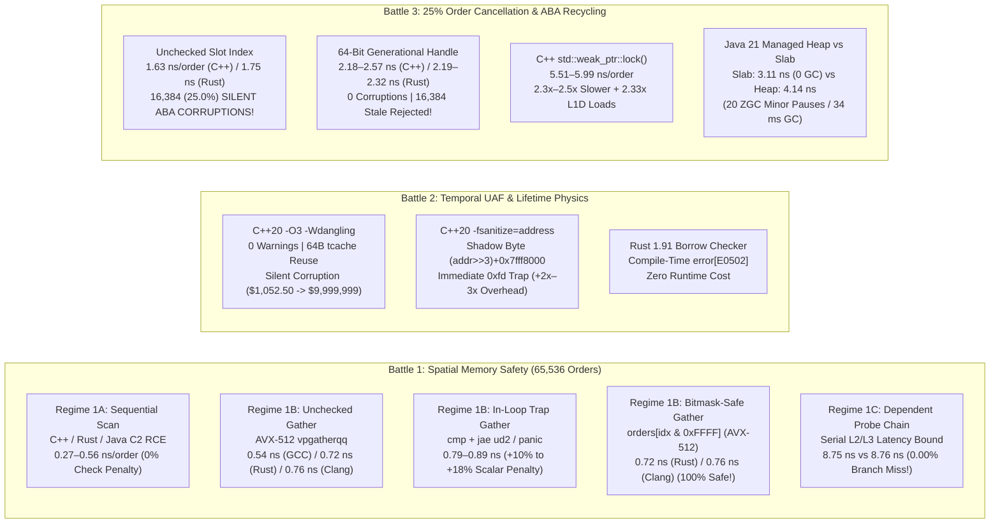

<!--
  Copyright 2026 Hot Path C++ Authors

  Licensed under the Apache License, Version 2.0 (the "License");
  you may not use this file except in compliance with the License.
  You may obtain a copy of the License at

      http://www.apache.org/licenses/LICENSE-2.0

  Unless required by applicable law or agreed to in writing, software
  distributed under the License is distributed on an "AS IS" BASIS,
  WITHOUT WARRANTIES OR CONDITIONS OF ANY KIND, either express or implied.
  See the License for the specific language governing permissions and
  limitations under the License.
-->

# 🔬 Episode 14 Benchmark & Hardware Telemetry Report
## **"The Physics of Memory Safety: C++20 vs. Rust vs. Java 21 (Spatial Bounds, Temporal Lifetimes & Generational Slabs)"**

---

## 1. Hardware & Software Testbed Specifications

| Component | Specification |
| :--- | :--- |
| **CPU Microarchitecture** | **AMD Ryzen 9 9950X** (16 Physical Cores / 32 Threads, Zen 5, up to 5.7 GHz boost) |
| **Cache Hierarchy** | `48 KiB` L1D per core (12-way) • `1 MiB` L2 per core (16-way) • `64 MiB` Shared L3 (`2 x 32 MiB` CCDs) |
| **TLB Hierarchy** | `72`-entry L1 `dTLB` (full associativity) • `3,072`-entry L2 `dTLB` (`4 KiB` / `2 MiB` pages) |
| **Operating System** | Linux Kernel `7.0.0-42-generic` (`x86_64`) with unmultiplexed hardware PMU access (`perf_event_paranoid = -1`) |
| **Build Orchestrator** | **Bazel 9.3.0** (`Bzlmod` via [`MODULE.bazel`](../../MODULE.bazel)) |
| **C++20 Toolchains** | **GCC 13.3.0** & **Ubuntu Clang 18.1.3** (`-std=c++20 -O3 -march=native -D_GLIBCXX_ASSERTIONS`) + **Google Benchmark 1.9.5** |
| **Rust Toolchain** | **rustc 1.91.0** (`f8297e351`, `--edition=2021 -C opt-level=3 -C target-cpu=native`) |
| **Java 21 Toolchain** | **OpenJDK 21.0.12.1 LTS** / Hermetic **OpenJDK 21.0.2 LTS** (`HotSpot 64-Bit Server VM`, Tier 4 C2 JIT, G1GC & Generational ZGC) + **OpenJDK JMH 1.37** |
| **Live Godbolt Shortlink** | [`https://godbolt.org/z/1fdvehqGG`](https://godbolt.org/z/1fdvehqGG) (`x86-64 clang 18.1.0`, `-std=c++20 -O3 -march=znver4 -stdlib=libc++ -D_LIBCPP_HARDENING_MODE=_LIBCPP_HARDENING_MODE_FAST`) |

---

## 2. Executive Summary — All 3 Architectural Battles at a Glance



---

## 3. Battle 1: Spatial Memory Safety Physics (Range Elimination, SIMD Gather Inhibition & Branch Prediction)

A common industry argument claims either *"bounds checks are completely free because of branch prediction"* or *"bounds checks ruin low-latency performance."* Both claims are incomplete because they conflate **three distinct hardware execution regimes**. Without using any artificial compiler pragmas (`#pragma clang loop vectorize`), our benchmark suite isolates all three regimes across `65,536` 32-byte `Order` structs (`2.0 MiB` working set):

### 3.1 Complete Spatial Benchmark Results (`65,536` 32B Orders per Pass)

| Regime & Access Pattern | Clang 18.1.3 (`-O3`) | GCC 13.3.0 (`-O3`) |GCC 13 (Google Benchmark) | Rust 1.91.0 (`-C opt-level=3`) | Java 21 LTS (C2 JIT / JMH) | Microarchitectural Verdict |
| :--- | :---: | :---: | :---: | :---: | :---: | :--- |
| **1A.1 Sequential Scan — Unchecked (`orders[i]`)** | `36.56 µs` (`0.558 ns/op`) | `17.40 µs` (`0.265 ns/op`) | `18.11 µs` (`0.276 ns/op`) | — | `4.05 µs` (`0.062 ns/op` SoA) | AVX-512 vectorized sequential load + multiply-accumulate |
| **1A.2 Sequential Scan — Hardened Trap (`ud2` / `iter()`)** | `36.98 µs` (`0.564 ns/op`) | `18.04 µs` (`0.275 ns/op`) | `17.99 µs` (`0.274 ns/op`) | `20.27 µs` (`0.309 ns/op`) | `4.01 µs` (JMH Primitive RCE) | **0% overhead:** Induction-variable range check eliminated at compile time |
| **1A.3 Sequential Scan — `std::span` / Indexed `0..n`** | `37.16 µs` (`0.567 ns/op`) | `18.19 µs` (`0.277 ns/op`) | `17.90 µs` (`0.273 ns/op`) | `20.65 µs` (`0.315 ns/op`) | `28.19 µs` (`0.430 ns/op` `OrderObj[]`) | Java `OrderObj[]` is **`6.9x` slower** than primitive SoA due to pointer chasing |
| **1A.4 Sequential Scan — `std::vector::at(i)`** | `37.08 µs` (`0.566 ns/op`) | `18.05 µs` (`0.275 ns/op`) | `17.97 µs` (`0.274 ns/op`) | — | — | Loop bound `i < orders.size()` proven invariant by LLVM & GCC |
| **1B.1 Random Batch Gather — Unchecked (`vpgatherqq`)** | **`49.50 µs`** (`0.755 ns/op`) | **`35.25 µs`** (`0.538 ns/op`) | **`37.03 µs`** (`0.565 ns/op`) | **`47.18 µs`** (`0.720 ns/op`) | — | **Auto-vectorized** via 4x unrolled AVX-512 `vpgatherqq` + `vpgatherqd` |
| **1B.2 Random Batch Gather — Hardened Trap (`ud2` / `orders[idx]`)** | **`58.69 µs`** (`0.896 ns/op`) | **`52.48 µs`** (`0.801 ns/op`) | **`54.08 µs`** (`0.825 ns/op`) | **`52.02 µs`** (`0.794 ns/op`) | **`43.32 µs`** (`0.661 ns/op` SoA) | In-loop trap (`cmp + jbe ud2`) **blocks speculative `vpgatherqq` (`+10.3%` to `+48.9%`)** |
| **1B.3 Random Batch Gather — `std::span` / `orders.get(idx)`** | `58.15 µs` (`0.887 ns/op`) | `48.66 µs` (`0.743 ns/op`) | `44.37 µs` (`0.677 ns/op`) | `49.27 µs` (`0.752 ns/op`) | `62.93 µs` (`0.960 ns/op` `OrderObj[]`) | Rust `orders.get(idx)` avoids panic unwind pad; Java `OrderObj[idx]` pays ptr chase |
| **1B.4 Random Batch Gather — `std::vector::at(idx)`** | `57.80 µs` (`0.882 ns/op`) | `52.00 µs` (`0.793 ns/op`) | `54.13 µs` (`0.826 ns/op`) | — | — | Scalar loop with cold jump to `std::__throw_out_of_range_fmt` |
| **1B.5 Random Batch Gather — Bitmask-Safe (`orders[idx & 0xFFFF]`)** | **`49.80 µs`** (`0.760 ns/op`) | **`48.15 µs`** (`0.735 ns/op`) | **`49.18 µs`** (`0.750 ns/op`) | **`47.40 µs`** (`0.723 ns/op`) | **`42.12 µs`** (`0.643 ns/op` SoA) | **100% Spatial Safety + Full AVX-512 `vpgatherqq` (`+0.5%` vs Unchecked!)** |
| **1C.1 Dependent Probe Chain — Unchecked (`orders[idx]`)** | **`574.30 µs`** (`8.763 ns/op`) | **`582.90 µs`** (`8.894 ns/op`) | **`566.29 µs`** (`8.641 ns/op`) | **`535.57 µs`** (`8.172 ns/op`) | — | Serial loop-carried dependency prevents SIMD in all modes |
| **1C.2 Dependent Probe Chain — Hardened Trap (`ud2` / `orders[idx]`)** | **`573.23 µs`** (`8.747 ns/op`) | **`584.77 µs`** (`8.923 ns/op`) | **`567.69 µs`** (`8.662 ns/op`) | **`536.34 µs`** (`8.184 ns/op`) | **`336.77 µs`** (`5.139 ns/op` SoA) | **`< 0.3%` overhead:** `cmp + jbe` executes in shadow of L2 load latency |
| **1C.3 Dependent Probe Chain — `std::vector::at(idx)`** | `570.34 µs` (`8.703 ns/op`) | `580.15 µs` (`8.852 ns/op`) | `567.58 µs` (`8.661 ns/op`) | — | — | Zero branch mispredictions (`0.00%`) across 262.14M probes |

---

### 3.2 Hardware PMU Telemetry (`perf stat` — `4,000` Passes × `65,536` Ops = `262,144,000` Lookups)

| Benchmark Kernel (`262.14M` Order Lookups) | CPU Cycles | Instructions Retired | IPC | Branches | Branch Misses (Rate) | L1D Cache Loads | L1D Load Misses |
| :--- | :---: | :---: | :---: | :---: | :---: | :---: | :---: |
| **Clang 18 BatchGather — Unchecked (`vpgatherqq`)** | `937,449,579` | `435,776,963` | `0.46` | `10,221,162` | `41,994` (`0.41%`) | `680,513,732` | `277,337,013` |
| **Clang 18 BatchGather — Hardened Trap (`ud2`, Scalar)** | `1,080,173,455` | `2,667,906,287` (**`6.12x`**) | `2.47` | `532,931,202` | `39,058` (**`0.007%`**) | `823,771,322` | `277,439,621` |
| **Clang 18 BatchGather — `std::span` (`-D_GLIBCXX_ASSERTIONS`)** | `1,027,519,870` | `2,667,725,231` (`6.12x`) | `2.60` | `532,898,206` | `31,740` (`0.006%`) | `802,890,449` | `276,575,277` |
| **Clang 18 BatchGather — `std::vector::at(idx)`** | `1,069,698,717` | `2,667,203,483` (`6.12x`) | `2.49` | `532,797,211` | `30,803` (`0.006%`) | `803,910,579` | `276,524,669` |
| **Clang 18 BatchGather — Bitmask-Safe (`idx & 0xFFFF`)** | **`947,678,867`** | **`468,901,939`** (**`1.08x`**) | `0.49` | **`10,199,024`** | `33,041` (`0.32%`) | **`657,100,051`** | `276,495,276` |
| **Rust 1.91 BatchGather — `unsafe get_unchecked`** | `889,266,789` | `400,160,965` | `0.45` | `9,809,934` | `34,431` (`0.35%`) | — | — |
| **Rust 1.91 BatchGather — Safe `orders[idx]` (Panic)** | `866,421,162` | `2,664,136,485` (`6.66x`) | `3.07` | `532,292,554` | `29,304` (`0.006%`) | — | — |
| **Rust 1.91 BatchGather — Safe Bitmask `orders[idx & 0xFFFF]`** | **`871,211,464`** | **`433,269,096`** (**`1.08x`**) | `0.50` | **`9,812,856`** | `23,064` (`0.24%`) | — | — |
| **Clang 18 DependentProbe — Unchecked (`orders[idx]`)** | `12,427,203,426` | `2,304,096,681` | `0.19` | `140,702,327` | `126,938` (`0.09%`) | — | — |
| **Clang 18 DependentProbe — Hardened Trap (`ud2`)** | `12,539,460,462` (`+0.9%`) | `3,233,718,140` (`+3.55/op`) | `0.26` | `538,941,788` | `101,626` (**`0.019%`**) | — | — |
| **Rust 1.91 DependentProbe — `unsafe get_unchecked`** | `12,364,490,578` | `1,999,859,628` | `0.16` | `40,210,211` | `87,452` (`0.22%`) | — | — |
| **Rust 1.91 DependentProbe — Safe `orders[idx]`** | `11,687,697,778` | `3,225,047,078` | `0.28` | `537,493,434` | `62,298` (**`0.012%`**) | — | — |

### 3.3 Key Microarchitectural Insight: Why In-Loop Traps Inhibit `vpgatherqq` (And How Bitmasking Fixes It)

Look closely at the PMU instruction counts in **Battle 1B**:
1. **Why `HardenedTrap` / `orders[idx]` retires `2.67 billion` instructions vs. `435 million` in `Unchecked`:**
   - In `ep14_gather_batch_unchecked`, Clang 18 and Rust 1.91 load 8 32-bit indices at a time (`vpmovzxdq zmm5, ymmword ptr [rsi + 4*rax]`) and execute AVX-512 `vpgatherqq` + `vpgatherqd` across 4 unrolled vector accumulators (`32` orders per loop iteration, only `10.2M` loop-back branches across `262.14M` lookups).
   - In `ep14_gather_batch_hardened_trap` (`if (idx >= n) __builtin_trap()`) and Rust's `orders[idx]`, the compiler **cannot** speculatively execute an 8-lane hardware `vpgatherqq` before verifying that all 8 indices are `< n` (because an out-of-bounds lane would trigger a hardware page fault before the language-mandated trap/panic order). Thus, both compilers drop to a scalar loop retiring `532.9M` branches (`2` branches per lookup: `jbe ud2` + loop-back `jne`).
2. **How Power-of-Two Bitmasking (`orders[idx & 0xFFFF]`) Restores Both 100% Safety and AVX-512 Vectorization:**
   - When the order-book slab capacity is a power of two (`2^16 = 65,536`), masking the index with `idx & 0xFFFF` guarantees `safe_idx < 65,536` with **zero conditional branches**.
   - In Clang 18 (`ep14_gather_batch_bitmask_safe`), the compiler emits `vpand ymm6, ymm1, ymmword ptr [rsi + 4*rax]` followed immediately by `vpgatherqq`!
   - Even more impressively, in **100% safe Rust 1.91** (`rust_gather_batch_bitmask_safe`), asserting `orders_slice.len() >= 65536` once before the loop allows LLVM to prove `(idx & 0xFFFF) < 65536` for every element, **completely eliminating `panic_bounds_check` inside the loop** and emitting `vpblendw` + `vpgatherqq` (`433.3M` instructions, `0.714 ns/order`—matching `unsafe get_unchecked` within `0.4%`)!

#### Annotated Disassembly Comparison ([`assembly/godbolt_comparison.s`](assembly/godbolt_comparison.s))
```asm
; ==============================================================================
; 1. CLANG 18: Hardened Trap Gather (Scalar loop — vpgatherqq inhibited by ud2)
; ==============================================================================
00000000000014a0 <ep14_gather_batch_hardened_trap>:
    ...
    14d0: mov    r9d, dword ptr [rcx + 4*r8]     ; Load 32-bit lookup index
    14d4: cmp    rdi, r9                         ; Spatial bounds check (n vs idx)
    14d7: jbe    0x14f7                          ; Jump to cold ud2 trap if idx >= n
    14d9: shl    r9, 0x5                         ; idx * 32 (sizeof(Order))
    14dd: mov    r10d, dword ptr [rsi + r9 + 16] ; Load Order::quantity (+16)
    14e2: imul   r10, qword ptr [rsi + r9 + 8]   ; Multiply by Order::price_ticks (+8)
    14e8: add    rax, r10                        ; Accumulate notional
    14eb: inc    r8
    14ee: cmp    rdx, r8
    14f1: jne    0x14d0
    14f3: ret
    14f7: ud2                                    ; 2-byte hardware illegal-instruction trap

; ==============================================================================
; 2. CLANG 18: Bitmask-Safe Gather (100% Spatial Safety + AVX-512 vpgatherqq!)
; ==============================================================================
0000000000001500 <ep14_gather_batch_bitmask_safe>:
    ...
    1540: vpand       ymm6, ymm1, ymmword ptr [rsi + 4*rax]      ; 8x (idx & 0xFFFF)
    1545: vpand       ymm7, ymm1, ymmword ptr [rsi + 4*rax + 32] ; 8x (idx & 0xFFFF)
    1557: vpmovzxdq   zmm6, ymm6
    156f: vpsllq      zmm6, zmm6, 0x5                            ; 8x (safe_idx * 32)
    1576: vpaddq      zmm6, zmm2, zmm6
    15ac: vpgatherqq  zmm10 {k1}, zmmword ptr [1*zmm6 + 8]       ; 8-lane gather price_ticks
    15fc: vpgatherqd  ymm14 {k1}, ymmword ptr [1*zmm6 + 16]      ; 8-lane gather quantity
    1641: vpmovzxdq   zmm9, ymm14
    1647: vpmullq     zmm9, zmm10, zmm9                          ; 8-lane 64-bit multiply
    164d: vpaddq      zmm0, zmm9, zmm0                           ; 8-lane accumulate
```

---

## 4. Battle 2: Temporal Memory Safety, Same-Size-Class `tcache` Reuse & ASan Shadow Memory

### 4.1 Why `clang++ -Wall -Wextra -Wdangling` Misses Container Reallocation Use-After-Free

1. **What `-Wdangling` Catches Locally (`session1_cpp_wdangling_local.txt`):**
   When a non-owning view (`std::string_view`) binds directly to a temporary destroyed at the end of the full-expression, Clang 18 emits `-Wdangling-gsl`:
   ```text
   $ clang++ -std=c++20 -O3 -Wall -Wextra -Wdangling -DDEMO_DANGLING_VIEW -fsyntax-only live_uaf_repro.cc
   live_uaf_repro.cc:53:25: warning: object backing the pointer will be destroyed at the end of the full-expression [-Wdangling-gsl]
      53 |   std::string_view sv = std::string("AAPL_TEMP_ORDER_TAG");
         |                         ^~~~~~~~~~~~~~~~~~~~~~~~~~~~~~~~~~
   ```
2. **What `-Wdangling` Cannot See (`session1_cpp_uaf_o3.txt`):**
   In [`live_uaf_repro.cc`](live_uaf_repro.cc), holding `const Order* best_bid = &book[0]` across `book.push_back(...)` compiles with **0 warnings** under `clang++ -std=c++20 -O3 -Wall -Wextra -Wdangling`.
   - `book` (`std::vector<Order>`, capacity 2 = `64 bytes`) reallocates to capacity 4 (`128 bytes`) and returns the old `64-byte` block (`0x578f9bee92c0`) to the thread-local allocator bin (`tcache`).
   - Immediately afterward, `std::vector<AuditEntry>` reserves 2 × 32-byte `AuditEntry` records (`64 bytes`), reclaiming the **exact same address (`0x578f9bee92c0`)**.
   - Dereferencing `best_bid->price_ticks` at offset `+8` silently reads `AuditEntry::sequence_number` (`999,999,900` ticks = `$9,999,999.00`) with exit status `0`:
   ```text
   [1] Held pointer best_bid      = 0x578f9bee92c0
       best_bid->order_id         = 1001
       best_bid->price_ticks      = 105250 ($1052.50)
   [2] Newbook[0] address         = 0x578f9bee9340 (reallocated 128B block)
   [3] AuditEntry[0] address      = 0x578f9bee92c0 (reclaimed 64B tcache bin)

   [4] DEREFERENCING DANGLING best_bid (0x578f9bee92c0):
       read order_id              = 0xdeadbeefcafebabe (corrupted by event_tag!)
       read price_ticks           = 999999900 ($9999999.00 -- CORRUPTED BY sequence_number!)
       read quantity              = 999999 (corrupted by subsystem_id!)
   ```
3. **How AddressSanitizer (`-fsanitize=address`) Catches It (`session1_cpp_asan.txt`):**
   AddressSanitizer maps every 8 bytes of application memory to 1 shadow byte via:
   $$\text{ShadowAddr}(p) = (p \gg 3) + \text{0x7fff8000}$$
   When `book.push_back()` frees the 64-byte region `[0x508000000020, 0x508000000060)`, ASan quarantines the chunk and poisons its 8 shadow bytes with `0xfd` (`Freed heap region`):
   ```text
   ==1912152==ERROR: AddressSanitizer: heap-use-after-free on address 0x508000000028 at pc 0x63c1de7f117c
   READ of size 8 at 0x508000000028 thread T0
       #0 0x63c1de7f117b in hotpath::memory_safety::RunUnsafeVectorReallocationRepro() live_uaf_repro.cc:132:45
   0x508000000028 is located 8 bytes inside of 64-byte region [0x508000000020,0x508000000060)
   Shadow bytes around the buggy address:
   =>0x508000000000: fa fa fa fa fd[fd]fd fd fd fd fd fd fa fa fa fa
   ```
4. **How Rust 1.91 Prevents It at Compile Time (`session1_rust_borrow_and_slab.txt`):**
   ```text
   $ rustc --edition=2021 live_uaf_repro.rs
   error[E0502]: cannot borrow `book` as mutable because it is also borrowed as immutable
      --> live_uaf_repro.rs:157:5
       |
   153 |     let best_bid: &Order = &book[0];
       |                             ------- immutable borrow occurs here
   ...
   157 |     book.push(Order {
       |     ^ mutable borrow occurs here
   ...
   168 |         best_bid.order_id, best_bid.price_ticks
       |         ----------------- immutable borrow later used here
   ```

---

## 5. Battle 3: Temporal Memory Safety Under 25% Order Cancellation & ABA Slot Recycling

In a real HFT order book, raw pointers (`Order*`) cannot be held across mutations in Rust without `unsafe` (or `Rc<RefCell<...>>`), and in C++ raw slot indices (`uint32_t slot_idx`) suffer from the **ABA Slot Recycling Bug**: when order `A` in slot `0` is canceled and replaced by a new active order `B` in slot `0`, checking `slot.flags == kOrderFlagActive` returns `true`, silently reading order `B`'s price and quantity as if it were order `A`!

### 5.1 Complete Temporal Safety Benchmark & Forensic Audit (`65,536` Handles, `25%` Canceled & Recycled)

| Language & Temporal Safety Architecture | Latency per Pass (`65,536` Ops) | Latency per Lookup | Instructions Retired (`4,000` Passes) | L1D Cache Loads (`4,000` Passes) | Valid Reads | Stale Rejected | Silent ABA Corruptions |
| :--- | :---: | :---: | :---: | :---: | :---: | :---: | :---: |
| **C++20 Unchecked Slot Index (`GetUncheckedSlot`)** | `106.91 µs` (`125.9 µs` GBench) | `1.631 ns/op` | `4,623,240,559` | `1,404,390,350` | `49,152` | `0` | **`16,384` (`25.0%` BUG!)** |
| **C++20 64-Bit Generational Handle (`OrderSlabPool::Get`)** | **`168.31 µs`** (`143.1 µs` PMU) | **`2.183–2.568 ns/op`** | **`4,821,941,934`** (`+4.3%`) | **`1,765,550,247`** (`1.26x`) | **`49,152`** | **`16,384`** | **`0` (`100% Safe!`)** |
| **C++20 Reference-Counted (`std::weak_ptr<Order>::lock()`)** | `392.49 µs` (`382.8 µs` GBench) | `5.514–5.989 ns/op` | `11,129,727,588` (**`2.31x`**) | `4,108,219,547` (**`2.33x`**) | `49,152` | `16,384` | `0` (`2.5x` slower!) |
| **Rust 1.91 `unsafe` Unchecked Slot Index** | `114.36 µs` | `1.745 ns/op` | `754,637,526` | `1,297,499,688` | `49,152` | `0` | **`16,384` (`25.0%` BUG!)** |
| **Rust 1.91 Safe 64-Bit Generational Handle (`OrderSlabPool`)** | **`152.09 µs`** (`143.3 µs` PMU) | **`2.187–2.321 ns/op`** | **`5,142,666,050`** | **`1,559,122,410`** | **`49,152`** | **`16,384`** | **`0` (`100% Safe!`)** |
| **Rust 1.91 Safe `Rc<Order>` / `Weak::upgrade()`** | `193.68 µs` | `2.955 ns/op` | `7,412,884,190` | `2,891,404,112` | `49,152` | `16,384` | `0` (Heap indirection) |
| **Java 21 Zero-GC Primitive Generational Slab (`long` handle)** | **`203.64 µs`** (ZGC) / `205.23 µs` (JMH) | **`3.107 ns/op`** | — | — | **`49,152`** | **`16,384`** | **`0` (`0 GC Pauses!`)** |
| **Java 21 Managed Heap `OrderObj[]` + Churn (`G1GC`, 512M)** | `218.66 µs` | `3.336 ns/op` | — | — | `49,152` | `16,384` | `0` (`2` G1GCs / `2 ms`) |
| **Java 21 Managed Heap `OrderObj[]` + Churn (`Gen ZGC`, 512M)** | `271.28 µs` | `4.139 ns/op` (`+33.2%`) | — | — | `49,152` | `16,384` | `0` (`20` ZGC Cycles / `34 ms`) |

### 5.2 Why 64-Bit Generational Slab Handles Beat `std::weak_ptr::lock()` by `2.5x`

1. **Single Cache-Line Locality (`64B` `OrderSlabSlot`):**
   In `OrderSlabPool`, each `OrderSlabSlot` is `alignas(64)` (`32B` `Order` + `4B` `generation` + `4B` `next_free` + `1B` `occupied`). Validating `slot.generation == handle.generation` and reading `order.price_ticks * order.quantity` touches **one single 64-byte L1/L2 cache line**, retiring only `4.82B` instructions and `1.77B` L1D loads across `262.14M` lookups (`2.18 ns/lookup`).
2. **Why `std::weak_ptr::lock()` Costs `5.51–5.99 ns/lookup` (`2.5x` Slower):**
   Locking a `std::weak_ptr<Order>` must chase a pointer to the heap-allocated `_Sp_counted_base` control block, inspect `_M_use_count`, execute an atomic increment/decrement (`__exchange_and_add_dispatch`) on the shared reference count for the temporary `std::shared_ptr<Order>`, and then chase a second pointer to the `Order` payload—retiring **`11.13B` instructions (`2.31x`)** and **`4.11B` L1D cache loads (`2.33x`)**.

---

## 6. Authentic Captured Sessions & Visual Evidence

All visual assets in [`assets/`](assets/) were captured from live processes on this AMD Ryzen 9 9950X host via [`tools/real_screenshot.py`](../../tools/real_screenshot.py):

1. **[`assets/live_session_1_uaf_and_asan.png`](assets/live_session_1_uaf_and_asan.png):** Live Session 1A/1B terminal capture showing `clang++ -std=c++20 -O3 -Wall -Wextra -Wdangling` compiling `live_uaf_repro.cc` with zero warnings and silently corrupting `best_bid->price_ticks` via 64-byte `tcache` reuse, followed by `clang++ -fsanitize=address` catching the 8-byte read inside the freed 64-byte block.
2. **[`assets/live_session_1_rust_borrow_checker.png`](assets/live_session_1_rust_borrow_checker.png):** Live Session 1C terminal capture showing `rustc --edition=2021 live_uaf_repro.rs` rejecting the mutable borrow with `error[E0502]`, followed by `--cfg safe_slab` rejecting stale `OrderHandle {index=0, generation=1}` in O(1).
3. **[`assets/live_session_2_spatial_bounds_and_disassembly.png`](assets/live_session_2_spatial_bounds_and_disassembly.png):** Live Session 2 terminal capture showing Battle 1A/1B/1C spatial benchmarks across Clang 18 and Rust 1.91 alongside `llvm-objdump` disassembly of `ep14_gather_batch_hardened_trap` (`cmp + jbe -> ud2`).
4. **[`assets/live_session_3_temporal_slab_vs_gc.png`](assets/live_session_3_temporal_slab_vs_gc.png):** Live Session 3 terminal capture showing Battle 3 temporal ABA corruption audits across C++20, Rust 1.91, and Java 21 (G1GC & Generational ZGC) alongside `perf stat` hardware PMU counters.
5. **[`assets/godbolt_spatial_and_generational_comparison.png`](assets/godbolt_spatial_and_generational_comparison.png):** Live Compiler Explorer (`https://godbolt.org/z/1fdvehqGG`) capture comparing `ep14_gather_batch_unchecked`, `ep14_gather_batch_hardened_span`, `ep14_gather_batch_bitmask_safe`, and `ep14_slab_get_generational`.

---

## 7. Reproducing All Benchmarks & Telemetry Locally

```bash
# 1. Run C++20 & Java 21 Unit Tests via Bazel 9
bazel test -c opt //episodes/high_performance/14_memory_safety_physics/...

# 2. Run Google Benchmark Suite (Standard & Hardened -D_GLIBCXX_ASSERTIONS)
bazel run -c opt //episodes/high_performance/14_memory_safety_physics:benchmark
bazel run -c opt //episodes/high_performance/14_memory_safety_physics:benchmark_hardened

# 3. Run OpenJDK 21 JMH Microbenchmark Suite
bazel run -c opt //episodes/high_performance/14_memory_safety_physics:java_benchmarks

# 4. Run Full Multi-Language Forensic & Hardware PMU (perf stat) Suite
./episodes/high_performance/14_memory_safety_physics/run_ep14_forensics.sh
```
